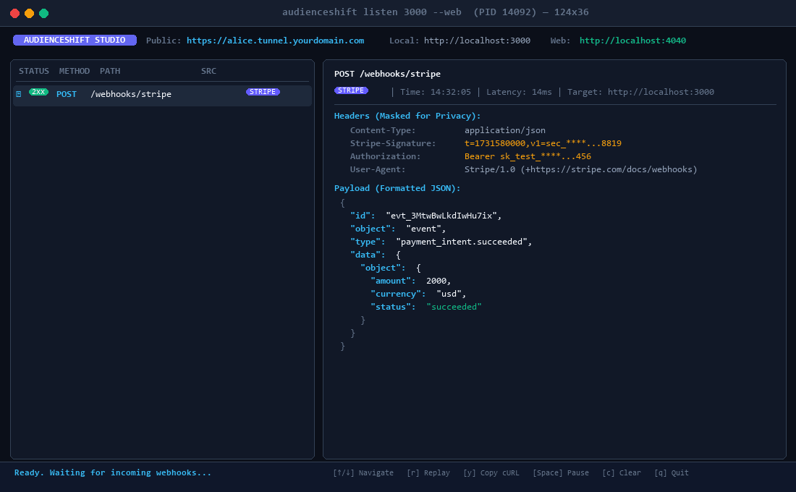
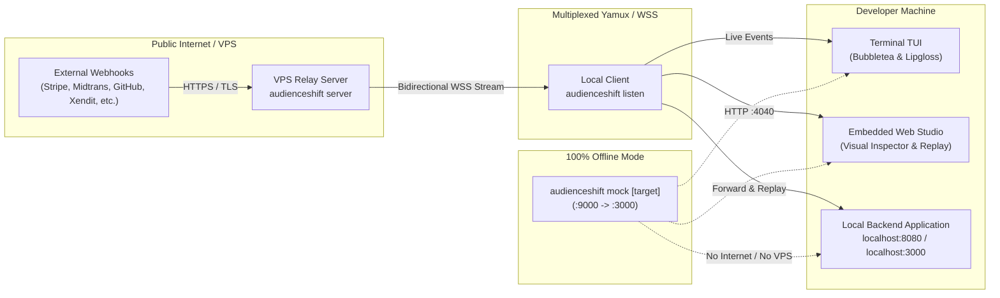

# AudienceShift 🚀

> **Sovereign Self-Hosted Webhook Studio & Reverse Tunnel**  
> Expose local services securely via your own VPS, inspect live webhooks through an interactive terminal TUI (or embedded Web Studio on `:4040`), mutate & replay events with automatic cryptographic signature recalculation, or test 100% offline with the standalone mock receiver.

[](https://goreportcard.com/report/github.com/pandusatrianura/AudienceShift)
[](LICENSE)
[](go.mod)
[](https://github.com/charmbracelet/bubbletea)

---

<p align="center">
  
</p>

---



---

## ⚡ Killer Features

1. **🛡️ Sovereign Self-Hosted Tunnel (Zero Paywalls & No Limits):**  
   Run a single Go binary on any \$3–\$5 VPS. Own your custom domain, get automatic TLS certificates via Let's Encrypt (ACME), and eliminate Ngrok rate limits, bandwidth fees, interstitial warning screens, and third-party data tracking.
2. **✈️ Offline Standalone Mock Webhook Receiver (`mock` Mode):**  
   Working on a plane, train, or isolated Docker network? Run `audienceshift mock 3000` to capture, inspect, and replay webhooks locally—100% offline without needing a VPS or internet connection.
3. **⚡ 1-Key Replay & In-Place Mutation Engine:**  
   Highlight any received webhook in your terminal and press `r` to instantly re-fire it against `localhost:8080`. Press `m` or use the Web Studio to mutate headers and JSON payloads to test edge cases without touching third-party dashboards.
4. **🔐 Smart Signature Auto-Detection & Recalculation:**  
   Detects provider HMAC signatures and verification tokens across **Stripe** (with timestamp tolerance refresh), **Midtrans** (SHA-512 `signature_key`), **GitHub** (`X-Hub-Signature-256`), **Slack** (`v0=...`), **Shopify** (`X-Shopify-Hmac-Sha256`), **Xendit** (`X-Callback-Token`), **GitLab** (`X-Gitlab-Token`), **Discord** (`X-Signature-Ed25519`), and **Twilio** (`X-Twilio-Signature`). When mutating payloads, AudienceShift automatically recalculates valid cryptographic signatures using your test secret so your local verification middleware passes.
5. **🔒 Built-in Privacy & Sensitive Data Masking:**  
   Automatic masking of `Authorization: Bearer ****`, `Cookie`, `X-Api-Key`, `X-Callback-Token`, and `X-Gitlab-Token` in both the Terminal TUI and Web Studio (with an interactive 1-click `[👁️ Reveal]` toggle for safe screen sharing and live streaming).
6. **📋 Developer Ergonomics & Full Observability:**  
   - **Terminal TUI Tab Toggle (`Tab`):** Instantly switch between `[Request]` and `[Response]` to inspect local backend status codes, latency, response headers, and JSON error bodies directly from your terminal.
   - **Vertical Payload Scrolling (`PgUp` / `PgDn`):** Smoothly scroll through massive payloads and multi-line traces.
   - **Interactive Live Filter (`/`):** Filter incoming webhooks on the fly by provider, HTTP method, or path.
   - **1-Key "Copy as cURL":** Press `y` in the TUI to export the selected webhook directly to your system clipboard via ANSI OSC 52, or click the `📋 Copy as cURL` button in Web Studio.
   - **Config Auto-Discovery:** Reads `.audienceshift.yaml` automatically so you can just type `audienceshift listen` with zero repetitive flags.
7. **🪟 Dual-Mode Studio (Terminal TUI + Embedded Web UI):**  
   - **Terminal TUI (Default):** Interactive split-pane terminal UI built with Bubbletea. Fast, responsive, keyboard-driven navigation (`Tab` toggle, `↑`/`↓`, `PgUp`/`PgDn`, `/` filter, `Space` pause, `r` replay, `y` copy cURL, `q` quit).
   - **Web Studio (`--web` flag):** Zero-npm, embedded dashboard at `http://localhost:4040` (auto port fallback `:4040` $\rightarrow$ `:4041`..`:4060`) featuring:
     - **Custom Webhook Composer:** Scratchpad to build, sign, and dispatch custom webhooks from scratch.
     - **Session Export:** Download captured webhooks in 1 click as JSON or Postman Collection v2.1 (or via CLI `--export events.json`).
     - **Response Diffing:** Visual side-by-side comparison between original and replayed responses.
8. **🛡️ Production Hardening & Ingress Protection:**  
   - **Healthcheck Endpoint (`GET /healthz`):** Built-in Docker/Kubernetes readiness and uptime monitor probe.
   - **Anti-DDoS Ingress Rate Limiting:** Token-bucket rate limiter per tunnel subdomain protecting local developer machines from flood attacks.
   - **Memory Guard:** Strict 10MB payload and response size limits preventing Out-Of-Memory (OOM) poison pills.
9. **🧪 Automated CI/CD Compliance Runner (`verify` Command):**  
   Run `audienceshift verify` in GitHub Actions or locally to audit whether your webhook handlers properly enforce cryptographic signature validation, reject forged headers, block expired replay timestamps, and handle duplicate deliveries idempotently.
10. **🎲 Universal Webhook Preset Catalog & Chaos Simulator:**  
    Send realistic simulated webhook payloads from 9+ major platforms without live third-party developer accounts, plus custom user-defined presets via `.audienceshift.yaml` and the `--duplicate` flag to stress-test idempotency.

---

## 🚀 Quickstart

### 1. Build from Source
```bash
go build -o bin/audienceshift ./cmd/audienceshift
```

### 2. Run Public Server (on your VPS)

#### Option A: Standalone Binary with Automatic Let's Encrypt TLS (ACME)
```bash
audienceshift server \
  --addr :443 \
  --domain tunnel.yourdomain.com \
  --acme \
  --acme-email admin@yourdomain.com
```

#### Option B: Docker Compose (1-Command VPS Setup)
```bash
docker compose up -d
```

### 3. Connect Local Client (on your Development Machine)

```bash
# Expose local port 3000 through your VPS tunnel
audienceshift listen 3000 --server wss://tunnel.yourdomain.com/tunnel/connect

# Launch with embedded Web Studio on localhost:4040
audienceshift listen 8000 --server wss://tunnel.yourdomain.com/tunnel/connect --web

# Run headless daemon mode in background or CI
audienceshift listen 8080 --server wss://tunnel.yourdomain.com/tunnel/connect --headless
```

### 4. Run Offline Mock Webhook Receiver (No VPS / No Internet Required)

```bash
# Capture webhooks locally on :9000 and forward to local app at :3000
audienceshift mock 3000

# Run offline mock with embedded Web Studio on :4040
audienceshift mock 8080 --port 9000 --web

# Pure recorder mode without forwarding
audienceshift mock --port 9000 --forward=false --headless
```

### 5. Trigger Webhook Presets & Chaos Idempotency Simulation

```bash
# List available webhook presets (Stripe, Midtrans, GitHub, Slack, Shopify, Xendit, GitLab, Discord, Twilio)
audienceshift trigger -list

# Trigger a mock webhook preset directly to your local backend
audienceshift trigger stripe:payment_intent.succeeded 3000 --secret whsec_test
audienceshift trigger xendit:invoice.paid 3000 --secret xnd_test_token
audienceshift trigger github:push 8080 --secret gh_test_secret

# Test consumer idempotency by firing duplicate concurrent requests (Chaos Mode)
audienceshift trigger midtrans:settlement 8080 --duplicate
```

### 6. Automated Webhook Compliance & Security Test Suite (`verify` Runner)

Run automated security and compliance audits against your local webhook handler or in CI/CD before merging PRs:

```bash
# Verify Stripe webhook handler compliance (valid HMAC, tampered rejection, anti-replay, idempotency)
audienceshift verify http://localhost:8080/webhooks/stripe --provider stripe --secret whsec_test

# Output machine-readable JSON for GitHub Actions / CI/CD pipeline automation
audienceshift verify http://localhost:3000/api/github --provider github --secret gh_secret --json
```

---

## ⚙️ Configuration File (`.audienceshift.yaml`)

Avoid repetitive CLI flags by placing `.audienceshift.yaml` in your project root or current working directory:

```yaml
# 1. Tunnel Connection
server: wss://tunnel.yourdomain.com/tunnel/connect
token: your-auth-token           # Optional auth token for VPS server
id: my-project                   # Desired subdomain: https://my-project.tunnel.yourdomain.com

# 2. Local Backend Target
target: 3000                     # Port number or full URL (e.g. 3000, 8080, http://localhost:3000)

# 3. Web Studio
web: true                        # Automatically start embedded Web Studio dashboard
web_addr: :4040                  # Web Studio port (auto-falls back to 4041..4060 if occupied)

# 4. Default Signing Secret
secret: whsec_test_secret_123    # Default secret for HMAC recalculation on replay

# 5. Provider-Specific Secrets (used by 'trigger' and automatic re-signing)
secrets:
  stripe: whsec_test_stripe_secret
  midtrans: SB-Mid-server-test-key
  github: my-github-webhook-secret
  slack: my-slack-signing-secret
  xendit: xnd_test_token
  gitlab: gl_test_token

# 6. Custom Company Presets
custom_presets:
  - id: internal:order.created
    provider: internal
    name: "Internal Order Created"
    description: "Company order lifecycle webhook"
    path: /api/webhooks/orders
    body: '{"order_id": "ORD-9999", "status": "PAID"}'
```

Now simply run:
```bash
audienceshift listen
```

---

## ⌨️ Terminal TUI Controls

| Key | Action |
| :--- | :--- |
| `↑` / `k` | Move cursor up in webhook event list |
| `↓` / `j` | Move cursor down in webhook event list |
| `Space` | Pause / Resume live incoming webhook stream |
| `r` | **Instant Replay:** Re-fire selected webhook to local backend (auto recalculates HMAC & Stripe timestamp) |
| `y` | **Copy as cURL:** Export full cURL command to system clipboard via ANSI OSC 52 |
| `m` | Trigger interactive mutation prompt |
| `c` | Clear captured event history |
| `q` / `Ctrl+C` | Quit AudienceShift |

---

## 🖥️ Embedded Web Studio (`:4040`)

When passing `--web` (or setting `web: true` in `.audienceshift.yaml`), AudienceShift starts a zero-npm web interface:

- **Automatic Port Fallback:** If port `:4040` is occupied (e.g. by Ngrok), it scans `:4041`..`:4060` automatically.
- **Real-Time Stream:** Server-Sent Events (SSE) stream webhooks into the browser with 15-second keepalive heartbeats.
- **Sensitive Data Masking:** One-click `[👁️ Reveal]` toggle to safely view masked tokens.
- **Copy as cURL:** One-click copy with all headers and body preserved.
- **Point-and-Click Replay & Mutation:** Edit JSON body in the browser, provide a secret key, and replay with 1 click.
- **Preset Catalog UI:** Trigger official presets directly to your localhost from the browser tab.

---

## 🛡️ Security, Defensibility & Rugged Architecture

AudienceShift is engineered according to the **Rugged Software Constitution**:

- **Subdomain Hijacking Defense:** Tunnel server generates cryptographically secure session ownership tokens. If an attacker attempts to claim an active subdomain without the matching token, the server returns `409 Conflict` and terminates the connection.
- **Poison Pill Defense:**
  - **ANSI Sanitization:** Raw strings rendered in the TUI are stripped of ANSI escape codes (`\x1b[...]`) and control characters, preventing terminal screen clears or cursor hijacking from malicious payloads.
  - **10MB Buffer Clamping:** Ingress streams use `io.LimitReader(10MB)` and return `413 Payload Too Large` to prevent memory exhaustion (OOM) attacks.
  - **Deadlines:** All ingress connections enforce strict 30-second read/write deadlines to mitigate Slowloris resource exhaustion.
- **Self-Loop Prevention:** The `mock` receiver detects if the forwarding target points to the mock receiver itself and refuses to start, preventing infinite amplification loops.
- **Stripe Replay Tolerance:** When replaying Stripe webhooks, AudienceShift updates the `t=...` timestamp in `Stripe-Signature` to `time.Now()` and recalculates HMAC, preventing 5-minute replay tolerance errors.

---

## 🧪 Architecture & Test Suite

All core packages follow **Testability-First** design with complete I/O isolation:

- `cmd/audienceshift`: CLI commands (`server`, `listen`, `mock`, `trigger`, `version`).
- `internal/features/inspector`: Bounded circular buffer (`MemoryStore`), thread-safe Pub/Sub (`EventBus`), HMAC signature verification/generation, and sensitive header masking.
- `internal/features/tunnel`: Gorilla WebSocket to `net.Conn` adapter with `hashicorp/yamux` multiplexed reverse tunnels.
- `internal/features/replay`: Pure mutation logic, timestamp refresh, and HTTP replay dispatch.
- `internal/features/tui`: Terminal dashboard built with Charm `bubbletea` & `lipgloss`.
- `internal/features/catalog`: Universal webhook presets for Stripe, Midtrans, GitHub, Slack, Shopify, Xendit, GitLab, Discord, and Twilio.
- `internal/features/config`: Hierarchical YAML configuration loader with flag precedence.
- `internal/features/web`: Embedded Web Studio SPA compiled via Go `embed.FS`.
- `test/e2e`: Comprehensive integration test suite verifying end-to-end webhook ingress, yamux streaming, offline mock receiver, and replay loops.

Run full test suite:
```bash
go test ./... -v
```

---

## 📄 License

MIT © [Pandu Satria Nur Ananda](https://github.com/pandusatrianura)
